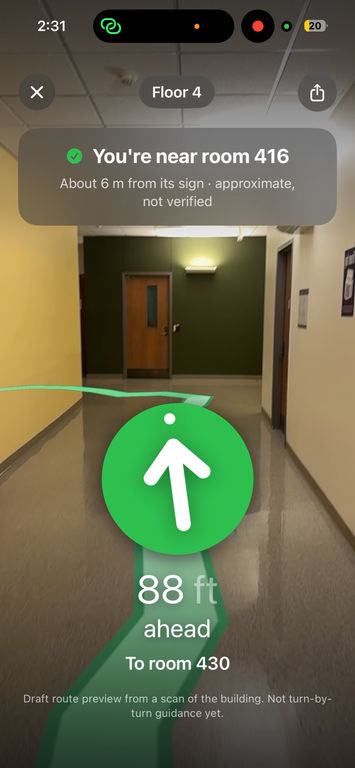
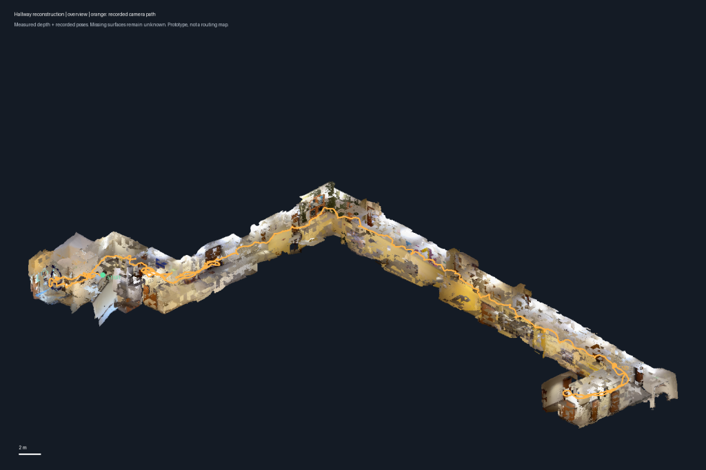

[View our DubHacks 2026 submission on Devpost](https://devpost.com/software/juno-s4y19m)
## Overview

Fuga combines LiDAR-based 3D reconstruction with a pretrained transformer-based matcher to estimate a phone camera’s position and orientation inside a building. 

Built at DubHacks 2026, it helps students and visitors at UW with indoor directions!

The reconstruction pipeline uses **Open3D’s volumetric TSDF fusion** to combine iPhone LiDAR scans into 3D hallway models. The localization pipeline uses **DISK**, a convolutional neural network, to extract visual features and **LightGlue**, a transformer-based matcher, to match those features against depth-backed reference views. **OpenCV’s PnP/RANSAC solver** then estimates the camera’s position and orientation.

The **SwiftUI** app uses **ARKit** to track movement, **SceneKit** to display routes, and **Dijkstra’s algorithm** to find paths through a hallway graph. Bundled **ElevenLabs** voice clips and **Core Haptics** provide spoken directions and vibration feedback.

## Demo

<table>
  <tr>
    <th>App route preview</th>
    <th>LiDAR hallway reconstruction</th>
  </tr>
  <tr>
    <td align="center"></td>
    <td align="center"></td>
  </tr>
</table>

Draft route preview and reconstructed scan; reliable automatic guidance remains unverified.

Watch the DubHacks pitch video (1:43)

https://github.com/user-attachments/assets/b75e3aec-a550-4b0f-b269-6a6d5ef7a89c

