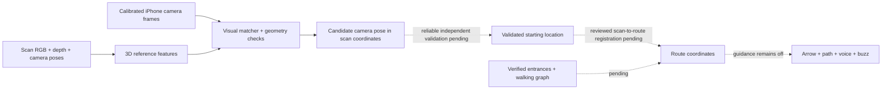

# How the reconstruction helps—and what is still disconnected

The user should not choose a starting room. The intended start is **Find where I am** using the live camera; selected floor is search context. Voice selects a destination independently. Room-number OCR is optional.

## Current source

The app's idle screen opens directly to the floor/camera/location flow. No starting-room or landmark selection is required. A destination can be spoken/typed before or after checking location. The feedback-test button plays samples, not real progress toward a room. Unknown location stays **Not located yet**; a calibrated numerical agreement stays **Possible location — unverified**. No route starts automatically or manually while registration/doors/paths remain unverified.

There are three different artifacts that must not be confused:

1. **Reconstructed scan mesh:** a colored surface model of captured areas. It is useful for inspecting coverage and geometry. Rendering this mesh is not camera localization, and it is not itself a walkable route graph.
2. **Depth-backed visual reference map:** features from scan images tied to 3D points by the scan's depth/calibration/poses. The Python DISK/LightGlue/PnP pipeline compares a calibrated phone image against these references to estimate camera position and direction in that scan's coordinates. v3/v4 currently cover the staircase/floor-4 recording. The new floor-2/3 meshes do not automatically provide matching reference maps.
3. **App route graph:** a separate floor-plan coordinate system with corridor connections and draft door destinations. It drives arrow/path/distance calculations after a correct starting pose is available in its coordinates. It is not registered to the canonical scan, and room 440 is still absent. The teammate's old 3D plan display was a separate visualization; the latest nav update removed it. The app still has a flat map/route implementation behind the guidance gate.

ARKit tracks relative movement and provides same-frame camera intrinsics/timestamps/poses. It does not automatically register the scan or floor plan. QuickLookModel compares capture-time scan-from-ARKit transforms and exports diagnostics; it does not initialize RouteNavigator. An agreeing scan transform is still not a verified route transform or physical doorway anchor.

## What must happen next

1. Build/run this latest merged source on the teammate's Mac/iPhone and verify portrait image/calibration/pose export.
2. Test calibrated independent-phone frames at independently known positions/directions. The matcher must reject ambiguous corridors; no threshold reduction to increase acceptance.
3. Review a rigid scan-to-route registration using distributed correspondences and independently check the actual 440 entrance(s) and traversable path. No approximate scale correction or invented coordinates.
4. Only then pass a confirmed starting pose into the route system and validate interruption handling, tracking drift, arrow direction and remaining-path-distance feedback.

Current honest answer: **the scan geometry supports the experimental location engine, but it is not yet driving live navigation in the app.** GPS is not fused; floor-2/3 recognition and independent-phone metric validation remain unfinished. Scans remain separate; labels and doorway/stair/elevator links remain draft or unknown. Routing stays disabled.
